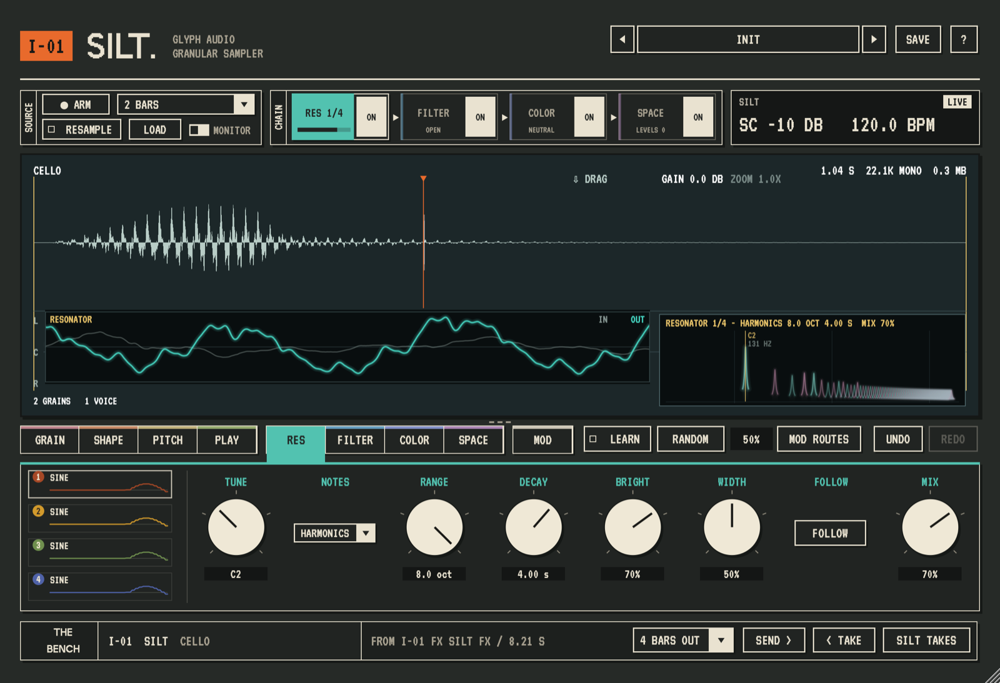

# Silt

A granular sampler plug-in from Glyph Audio, for macOS (AU, VST3, CLAP and standalone).



Silt is built twice from one codebase:

| Build | Goes on | Plays |
|---|---|---|
| **Silt** | a MIDI track | a sample you load, record from another track, or resample from itself |
| **Silt FX** | an audio track | its own track's audio, live, with or without MIDI |

## Features

- **Grains:** 16 voices, each a playhead through the sample with its own ADSR, up to 64
  grains at once, with size, rate, spray, reverse, pitch scatter and a shaped grain
  envelope.
- **Four ways to play** (Silt): **PITCH** plays the sample from the keys, **LIVE** grains
  the incoming audio a moment behind, **FEED** keeps re-granulating its own output, and
  **SLICE** puts a slice on each key, cut equally, at the sample's hits or by hand.
- **Pitch:** scales and keys, a stepped pitch pattern, and up to eight playheads per note.
- **Effects in any order:** a 128-mode resonator that follows the notes and chords you
  play (tuned to a scale, the harmonic series, bell partials or the sample's own
  spectrum), a ladder filter, COLOR (drive, bits, rate, compression, noise, wow) and
  SPACE (tape-style delay and a large reverb with shimmer).
- **Modulation:** four modulators (wave, random, envelope, input follower, MIDI, macro,
  or a fresh value for every grain), routed by dragging onto any knob, per voice if you
  like, and able to modulate each other.
- **51 factory sounds** and a preset browser with search, categories and favourites.
- **Eight controls a page**, so any 8-knob MIDI controller plays every page, with pickup
  so values never jump.
- **The Bench:** send a few bars of output to another Glyph Audio plug-in, or take what
  another sent as the sample.
- The sample is saved with your project; almost everything is undoable.

Everything is described control by control in the [manual](docs/MANUAL.md).

## Status

Version 0.1.0. It's developed and tested in Ableton Live 12 on macOS; other hosts
are untested and a Windows build is in progress.

## Install

Download `Silt-<version>-macOS.pkg` from the
[latest release](https://github.com/Jackherz/silt/releases/latest). It works on Apple
Silicon and Intel Macs, and installs Silt and Silt FX as VST3, Audio Unit and CLAP
plug-ins and as standalone apps. It's free, and not notarised by Apple, so macOS asks
you to allow it once:

1. Open the package. macOS says it can't verify it: click **Done**.
2. Open **System Settings > Privacy & Security**, scroll to *Security*, and click
   **Open Anyway** beside the message about Silt. Confirm with your password.
3. The installer opens. Install, then restart your DAW and rescan its plug-ins.

Silt takes its recording input from a sidechain: in Live, pick the source track in the
device's sidechain section.

## Build from source

Needs macOS with the Xcode command line tools, CMake 3.22+ and Ninja. JUCE 8 and the
other dependencies are fetched when you configure.

```bash
git clone --recurse-submodules https://github.com/Jackherz/silt.git
cd silt
cmake -S . -B build -G Ninja -DCMAKE_BUILD_TYPE=Release
cmake --build build
```

The build copies Silt and Silt FX into `~/Library/Audio/Plug-Ins/`. Restart your DAW
and rescan. `bash scripts/package-macos.sh` makes the installer package instead. Tests, validation and the code layout are in [DEVELOPMENT.md](docs/DEVELOPMENT.md).

## Part of Glyph Audio

Silt is the instrument of a small family of plug-ins drawn on one shared panel kit,
[glyph-audio-kit](https://github.com/Jackherz/glyph-audio-kit), alongside
[Brood](https://github.com/Jackherz/Brood), a looper and spatial effect.

## Licence

Silt is free software under the GNU GPL v3 ([LICENSE](LICENSE)), factory samples included.
It uses [JUCE](https://juce.com) under the AGPLv3; that and the other components'
licences are in [THIRD_PARTY_NOTICES.md](THIRD_PARTY_NOTICES.md).
